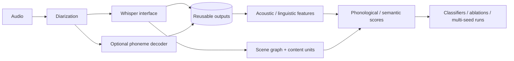

# IPSS-PPA · Interpretable Speech & Semantic Evaluation

**Python · ML pipelines · speech processing · graph algorithms · model evaluation**

A research pipeline that turns picture-description speech into interpretable phonological and semantic features, then evaluates those features with classical classifiers. The project combines diarization, speech recognition, optional phoneme decoding, scene-graph scoring, and experiment orchestration behind reusable Python interfaces.

This is collaborative research code associated with the IPSS-PPA manuscript. See [citation and authorship](docs/CITATION.md). It showcases pipeline and evaluation engineering; it is not a deployed clinical product.

## Engineering and research highlights

- **Staged inference:** diarization → timestamped ASR → optional acoustic-to-phoneme decoding → structured features → classifiers.
- **Replaceable model interfaces:** lazy-loaded ASR and phonetic backends separate expensive inference from feature and experiment code.
- **Reusable intermediates:** disk caches keyed by subject/path and artifact type, plus skip-existing execution for pipeline outputs.
- **Interpretable graph scoring:** canonical entities and relation rules map transcripts to a scene graph; node/content-unit coverage provides inspectable evidence.
- **Evaluation tooling:** logistic regression/random-forest comparisons, ablations, multiple seeds, and failure-analysis scripts.
- **Model artifacts:** baseline persistence records classifier, scaler, feature schema, imputation medians, and per-feature contributions.

## Architecture



| Area | Entry point |
| --- | --- |
| Configuration and CLI | [src/config.py](src/config.py), [src/cli.py](src/cli.py) |
| Audio pipeline orchestration | [src/pipeline/runner.py](src/pipeline/runner.py) |
| Model interfaces | [src/models/](src/models/) |
| Cache and dataset contracts | [src/io/](src/io/) |
| Graph-based semantic scoring | [src/features/graph_semantic.py](src/features/graph_semantic.py) |
| Phonological scoring | [src/features/phoneme_adequacy.py](src/features/phoneme_adequacy.py) |
| Training and explanations | [src/train/baseline.py](src/train/baseline.py) |
| Experiment entry points | [scripts/README.md](scripts/README.md) |

## Try the offline example

Use Python 3.11 or 3.12. The small example needs no recorded speech, credentials, downloaded models, or GPU.

```bash
python3 -m venv .venv
source .venv/bin/activate
python -m pip install -r requirements-core.txt
python scripts/demo_semantic_scoring.py
python -m pytest -q tests
```

The example compares fictional scene descriptions and prints semantic coverage and matched content units. It demonstrates scoring behavior, not diagnostic accuracy.

## Run the research pipeline

Install `requirements.txt` for the full audio/NLP stack; model files and external decoder code require separate provisioning. CLI entry points and dataset schemas are documented in [reproduction](docs/REPRODUCING.md).

```bash
python -m src.cli --help
python -m src.cli ppa-pipeline --help
```

The current source tree keeps code, the reference scene graph, documentation, and synthetic tests. Audio, subject-level manifests, caches, and generated outputs remain local and are excluded from the current tracked tree. Earlier Git history is preserved.

## Research evidence

The original project reports experiments over 254 recordings (25 controls; 42 svPPA, 78 nfvPPA, 109 lvPPA). Historical single-seed results include 85.1% accuracy / 0.932 ROC-AUC for control-versus-svPPA and 82.1% / 0.734 for subtype discrimination. They are retained as reported research outcomes, not independently reproduced or clinical-validation claims.

Some historical classifiers scale features before cross-validation; population normalization and repeated-subject/session grouping also require audit. These limitations should be resolved before relying on the reported estimates. [Evaluation notes](docs/EVALUATION.md) distinguish the historical evidence from the checks performed for this cleanup.

## Read more

- [Architecture and implementation tradeoffs](docs/ARCHITECTURE.md)
- [Methods](docs/METHODOLOGY.md)
- [Reproduction and data contracts](docs/REPRODUCING.md)
- [Evaluation boundaries](docs/EVALUATION.md)
- [Research citation](docs/CITATION.md)

Publication/licensing status is not inferred from the presence of a citation. Preserve the original collaborative attribution and upstream model terms.
